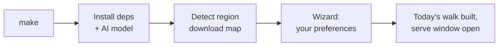
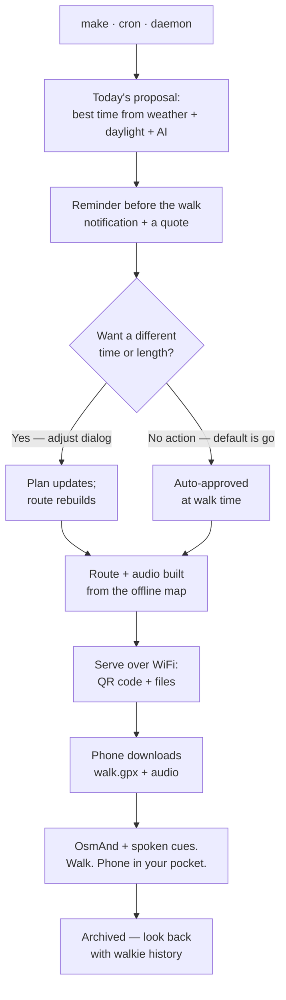

# walkie

**A walk planner that decides for you, so you spend less time on a screen and more time outside.**

You tell walkie once when you like to walk, for how long, and how. After that it
plans each day's walk for you: it picks the best time around the weather and
daylight, builds a walking loop from your door, and turns the directions into
spoken cues. Then you put the phone in your pocket and go.

Everything runs on your own laptop with open-source AI. After setup, planning
and building a walk need no internet connection.

## How a day with walkie works

1. **It picks a time.** walkie checks today's forecast and daylight, and a
   small AI model running on your laptop picks your walk window. If rain or
   heat is coming, it moves the walk.
2. **It reminds you.** You get a reminder 30, 15 and 5 minutes before the
   walk, each with a short motivational quote. Want a different time? Change
   it in a quick dialog. If you do nothing, the plan is approved: the default
   is that you go.
3. **It builds a route.** walkie builds a loop that starts and ends at your
   door and fits the walk's length, using an offline map of your area.
4. **It talks you through the walk.** The turns become spoken cues
   ("Turn right") timed to your walking pace, in one audio file. Play your
   own music alongside it.
5. **It sends everything to your phone.** Your phone downloads the route and
   the audio over your home WiFi. Open the route in OsmAnd, start the audio,
   and walk.

## Why open-source AI

| | |
| --- | --- |
| **Private** | No account, no tracking. The AI runs on your laptop, so your plans never go to an AI company's servers. |
| **Works offline** | With a saved forecast and the downloaded map, it still plans, builds the route and speaks the cues with no signal. |
| **Free to run** | No API fees, no subscription. |
| **Yours to change** | The model, the prompts and your preferences are all local files. Switch to another model by editing one line. |

The open pieces it's built on:

- [Llama 3.2 3B](https://ollama.com/library/llama3.2) through [Ollama](https://ollama.com), which plans the walk
- [Piper](https://github.com/rhasspy/piper), local text-to-speech for the voice cues
- [OpenStreetMap](https://www.openstreetmap.org) and [OSMnx](https://github.com/gboeing/osmnx), which build the route

## What you need

- macOS or Linux with **Python 3.10+**
- **[Ollama](https://ollama.com/download)** installed
- About **3 GB of free disk space**: 2 GB for the AI model plus the map of your
  region, which varies by size (Nigeria is about 700 MB)
- Optional: **[OsmAnd](https://osmand.net)** on your phone (free) to follow the
  route, with the phone on the same WiFi as your laptop

## Quick start

```bash
make
```

That is the whole interface. The first time (internet required) it installs
everything, downloads your region's map, opens a short window for your walk
preferences, builds today's walk and starts the phone server. Every later day
the same command rebuilds only what has changed and serves the result —
`make` and a bare `walkie` both mean `walkie go`.

Useful variations:

- Wrong region detected? `make region`
- Change your usual walk time, length or pace? `make wizard` — only needed
  occasionally; for a quick tweak use `walkie schedule --time 17:00 --duration 45`
- Already set up, just rebuild? `make run`
- Serve files only? `make serve`

`make serve` opens a window with a QR code, a map of today's loop and the
file list. Scan the QR with your phone camera (phone on the same WiFi);
`walkie serve --no-window` does the same from the terminal. Your phone can
download:

- `walk.gpx`: the route. Open it in OsmAnd.
- `walk_audio.mp3`: the spoken turn cues.
- `card.html`: a shareable card of today's walk (screenshot to share).
- `today_plan.json`: today's walk time and the reason for it.

**Run it automatically.** Add this line to your crontab (`crontab -e`) and
walkie keeps today's plan up to date and sends the reminders on its own. It
only rebuilds what has changed, so running it every minute is cheap.

```bash
* * * * * cd /path/to/walkie && .venv/bin/walkie run >> output/cron.log 2>&1
```

Prefer a background service over cron? `walkie daemon` does the same job as
a long-running process, and `walkie daemon --install` starts it at login
(macOS launchd).

**Change your schedule anytime.** `walkie schedule --time 16:30 --duration 45`
updates when and how long you walk; today's walk rebuilds around it on the
next run.

### The flow at a glance

First run — one time only:



Every day after — the same `make`, or cron/daemon doing it for you:



## Commands

Each `make` target maps to one `walkie <command>` (exceptions: `make setup`
runs the install script; `test`/`lint`/`typecheck` are dev tools). After
`pip install -e .` you can type `walkie <command>` directly — that is also
how you pass flags, since `make` targets take none.

| Command | What it does |
| --- | --- |
| `make` (or `walkie go`) | **The one command:** fill any setup gaps, build today's walk, serve it (flags: `walkie go --build-only`, `--force`, `--port N`) |
| `make setup` | Install dependencies, the AI model and your region's map |
| `make wizard` | Set your standing walk preferences (occasional — quick tweaks go through `walkie schedule`) |
| `make region` | Detect your location again and download its map |
| `make run` | Run the whole pipeline: suggest → plan → route → voice → card (`walkie run --force` rebuilds everything) |
| `make suggest` | Suggest today's walk time (`walkie suggest --edit` to adjust it) |
| `make plan` | Let the AI finalise today's plan |
| `make route` | Build the walking loop (`walkie route --minutes N` to change its length) |
| `make voice` | Turn the route into spoken cues |
| `make remind` | Send any reminder that's due, then exit |
| `make daemon` | Background service: keeps today's walk current and sends reminders (`walkie daemon --install` to start at login) |
| `make serve` | Share today's files with your phone (`walkie serve --port N`, `--no-window`) |
| `make history` | Look back at past days' plans (`walkie history --limit N` to change how many) |
| `make card` | Build a shareable card of today's walk (`output/card.html`) |
| `make qr` | Print a QR code that opens the sync page on your phone |
| `make schedule` | View or change your walk schedule (e.g. `walkie schedule --time 16:30 --duration 45`) |

## Configuration

You never need to edit code. Change these files instead:

| File | What's in it |
| --- | --- |
| `config/user_plan.json` | Your walk preferences: time, length, shade or sun, pace. The wizard writes this. |
| `config/settings.yaml` | Your region and location, the AI model, the voice |
| `config/quotes.txt` | The motivational quotes. One per line, edit freely. |

To use a different AI model, pull it with Ollama (for example
`ollama pull gemma3`) and change `ollama.model` in `config/settings.yaml`.

## What goes over the internet

The AI and your preferences stay on your laptop. walkie only goes online for
these:

| When | What | Why |
| --- | --- | --- |
| Setup | Your IP address, to an IP-location service, plus a reverse-geocode lookup on OpenStreetMap | To find your region |
| Setup | Downloads from Geofabrik, Ollama and Hugging Face | The map, the AI model and the voice |
| Daily, when online | Your coordinates, to [Open-Meteo](https://open-meteo.com) (no account) | The weather forecast. When you're offline, walkie uses the last saved one. |
| When the serve window is open | Map preview tiles from [OpenStreetMap](https://www.openstreetmap.org) | Drawing the map behind the route (tiles are cached; without them the window still works) |

## Project layout

```
walkie/
├── config/        your settings, preferences and quotes
├── data/          downloaded map (osm/) and voice model (voices/)
├── output/        today's plan, route and audio (created when it runs)
├── src/walkie/    the code
│   ├── suggest/   suggests today's walk and sends reminders
│   ├── ai/        the AI planner
│   ├── routing/   builds the walking loop from the map
│   ├── media/     turns the route into spoken cues
│   ├── sync/      notifications, the phone server and the QR code
│   ├── go.py      the one-command entry (make / walkie go)
│   ├── daemon.py  background service (walkie daemon)
│   ├── card.py    the shareable walk card
│   ├── schedule.py view/change your walk schedule from the CLI
│   ├── autoschedule.py plan your first walk during setup
│   ├── history.py keeps past days' plans
│   └── ui/        the setup wizard and the adjust dialog
├── tests/
└── docs/          how it's built and how it's tested
```

## For developers

```bash
make test        # tests (with a coverage floor)
make lint        # ruff
make typecheck   # mypy --strict
```

- [docs/architecture.md](docs/architecture.md): the design architecture — components, data flow and decisions
- [docs/build_logic.md](docs/build_logic.md): how the steps connect
- [docs/test_protocol.md](docs/test_protocol.md): the test plan for each step
- [TEST_LOG.md](TEST_LOG.md): the field-testing log

## License

MIT — see [LICENSE](LICENSE).
