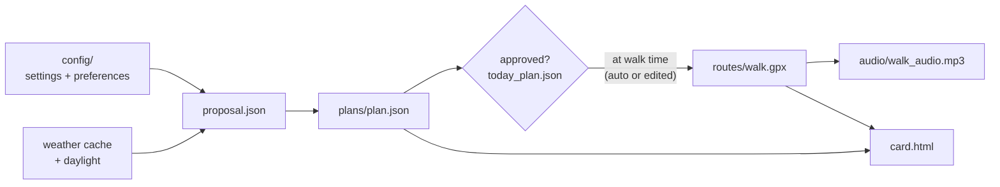

# Architecture

walkie is an offline-first walk planner that runs entirely on your laptop.
There is no cloud service, no account, and no database server: one Python
package, files on disk, a local AI model, and a tiny LAN server that hands
today's walk to your phone. The phone is a dumb HTTP client — it never
talks to anything but your laptop.

## System context

```mermaid
flowchart LR
    subgraph laptop["Your laptop"]
        walkie["walkie<br/>(CLI + windows)"]
        llm["Ollama<br/>local LLM"]
        tts["Piper TTS"]
        osm["OSM extract<br/>(offline map)"]
        out[("output/<br/>today's walk")]
        walkie --> llm
        walkie --> tts
        walkie --> osm
        walkie --> out
    end
    subgraph net["Internet (best-effort)"]
        meteo["Open-Meteo"]
        geo["Geofabrik + Hugging Face"]
        tiles["OSM map tiles"]
    end
    subgraph pocket["Your phone"]
        page["Browser page +<br/>OsmAnd (offline)"]
    end
    meteo -.->|"forecast (cached)"| walkie
    geo -.->|"map + model (one-time)"| walkie
    tiles -.->|serve window| walkie
    out --|"HTTP on home WiFi"| page
```

Everything in the dotted box is optional after setup: when the internet is
down, walkie falls back to cached inputs and still plans, builds and serves.

## Module map

Four layers, dependencies point downward only:

| Layer | Modules | Responsibility |
| --- | --- | --- |
| Interface | `cli.py`, `ui/` | argv parsing and exit codes (the only module that exits); PyQt wizard, adjust dialog, serve window |
| Orchestration | `go.py`, `pipeline.py`, `daemon.py`, `autoschedule.py` | fill setup gaps; chain one build pass; keep passes running; first walk at wizard time |
| Domain | `suggest/`, `ai/`, `routing/`, `media/`, `card.py`, `history.py`, `schedule.py` | proposal + reminders, plan decision engine, route builder, voice cues, share card, archives, schedule overrides |
| Platform | `config.py`, `models.py`, `storage.py`, `policy.py`, `clock.py`, `geo.py`, `llm.py`, `weather.py`, `daylight.py`, `region.py`, `log.py`, `sync/` | paths + validated settings, dataclasses, atomic JSON, validators, time, Ollama client, Open-Meteo cache, daylight, region fetch, logging, notifications + LAN server + QR |

## Data flow

Each stage reads only `config/`, `data/`, and the previous stage's
`output/` — never the network (except weather's cached refresh) and never
another stage's inputs:



`walkie serve` puts `output/` on the LAN; nothing else consumes these files
— they are all regenerable from config.

## Runtime modes

| Mode | Entry point | Lifetime | Typical use |
| --- | --- | --- | --- |
| Bootstrap + daily | `make` / `walkie go` | until you stop serving | the one command: fill gaps, build, serve |
| One-shot build | `walkie run` | seconds | cron, `* * * * *` |
| Hands-off service | `walkie daemon [--install]` | until stopped (or login, via launchd) | no cron |
| Phone handoff only | `walkie serve` | until Ctrl-C | files already built |

## Key design decisions

1. **Local-first AI.** The planner is a one-shot call to an open-weight
   model through Ollama; voice cues come from Piper. No API keys, no
   accounts, no per-use cost — and it keeps walk plans off third-party
   servers.
2. **Files are the database.** Preferences live in `config/user_plan.json`
   and `config/settings.yaml` (hand-editable); state lives in `output/`
   (regenerable). `storage.py` does atomic JSON writes. There is nothing
   to migrate, back up, or corrupt silently.
3. **Loud validation, graceful degradation.** Invalid config raises
   `ConfigError` with a remedy ("run: walkie wizard") instead of silently
   defaulting. Model replies are validated against `policy.py` and
   discarded when they drift; the weather falls back to the last cache;
   map tiles fall back to no map. Setup failures are hard; runtime
   failures degrade.
4. **Idempotent, staleness-driven pipeline.** Every stage reuses today's
   output unless it is missing, older than its inputs, or `--force`d
   (`pipeline._stale`). An every-minute cron stays cheap.
5. **Approval gate before expensive work.** Route and voice build only
   after `today_plan.json` exists — auto-approved at walk time, or edited
   via the adjust dialog — so the pipeline never chases an unapproved plan.
6. **One exit boundary.** Modules raise typed errors (`ConfigError`,
   `RegionError`, `RouteError`, `VoiceError`, `SyncError`); only
   `cli.py` maps them to exit codes. Everything is importable and testable
   without subprocesses.
7. **Qt only at the edges.** PyQt is imported lazily inside UI paths, so
   the core stays headless-testable (tests run with `QT_QPA_PLATFORM=offscreen`).
8. **One-command bootstrap.** `walkie go` fills gaps in a fixed order —
   settings file, region extract, wizard — each step a no-op when already
   satisfied, so first run and day 100 are the same command.
9. **LAN-only delivery.** The phone fetches files over home WiFi from a
   stdlib HTTP server; the laptop stays the system of record. No sync
   protocol, no pairing, no cloud.
10. **Single-instance, config-hot-reloading daemon.** `daemon.py` guards
    with `cache/daemon.pid`, swallows per-pass errors, and re-reads
    settings when their mtime changes.

## Offline behaviour

| Capability | Fully offline? | Fallback |
| --- | --- | --- |
| Plan today's walk | yes | cached weather; model falls back to deterministic inputs |
| Build route + audio | yes | street graph cached in `cache/routes/`, voice model in `data/voices/` |
| Reminders, serve to phone | yes | LAN only |
| Refresh the forecast | no | keeps the last cache |
| Serve-window map tiles | no | window works without a map |
| First-time setup | no | needs one-time downloads |

## Stack

Python 3.10+ · PyQt6 · [Ollama](https://ollama.com) + Llama 3.2 3B ·
[Piper](https://github.com/rhasspy/piper) TTS · OSMnx / networkx / osmium ·
astral (daylight) · Open-Meteo (weather) · segno (QR) · pyyaml ·
pytest + ruff + mypy --strict (coverage floor 84%).

## Testing

Every module is unit-tested in isolation; pipeline and orchestration tests
inject fakes (`llm_fn`, `synth`, `notify_fn`, weather) instead of
mocking globals. Field behaviour follows [test_protocol.md](test_protocol.md)
and is logged in [../TEST_LOG.md](../TEST_LOG.md), including the
airplane-mode chain.
